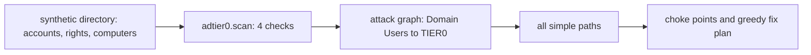

# Component: on-premises AD Tier 0 and choke points

Hybrid tenants inherit the on-premises domain's weaknesses. Four checks over a synthetic directory find
Kerberoastable service accounts, DCSync rights outside the domain controllers, unconstrained delegation on
ordinary servers, and delegation that lands on a domain controller. Each finding becomes an edge from "any
domain user" towards Tier 0, and the nodes most paths share are ranked as choke points, with a fix order
that cuts every path.

Sections: [1. Purpose](#1-purpose) · [2. Architecture](#2-architecture) · [3. How it works](#3-how-it-works) · [4. Key files](#4-key-files) · [5. Code excerpts](#5-code-excerpts) · [6. Configuration](#6-configuration) · [7. Commands](#7-commands) · [8. Real output](#8-real-output) · [9. Tests and gates](#9-tests-and-gates) · [10. Guardrails](#10-guardrails) · [11. Security and governance](#11-security-and-governance) · [12. Observability](#12-observability) · [13. Failure modes](#13-failure-modes) · [14. Mapping to Azure services](#14-mapping-to-azure-services) · [15. Limitations](#15-limitations) · [16. Interview talking points](#16-interview-talking-points)

## 1. Purpose

* Find the classic routes to domain admin and rank what to fix first by how many routes each fix cuts.
* Keep look-alikes clear: a group managed service account, a disabled account, the documented directory-sync
  account, a read-only replication right, the domain controllers' own delegation, delegation to a file server.

## 2. Architecture



## 3. How it works

1. Kerberoastable: enabled, non-gMSA accounts with an SPN; critical when in a Tier 0 group, high when the
   password is old or RC4 is allowed.
2. DCSync: both replication rights on the domain root held by something other than the domain controllers
   (the directory-sync account is a documented exception and listed as a Tier 0 asset).
3. Unconstrained delegation outside the domain controllers; constrained or resource-based delegation onto a
   domain controller.
4. `choke_points` counts paths through each node; `fix_plan` picks fixes greedily until no path is left.

## 4. Key files

| File | Role |
|---|---|
| `src/idsec/adtier0.py` | Directory, checks, graph, paths, choke points, fix plan and evaluation |

## 5. Code excerpts

<!-- code: src/idsec/adtier0.py::scan -->
```python
def scan() -> list[Finding]:
    out: list[Finding] = []
    for a in ACCOUNTS:
        if a["spn"] and a["enabled"] and not a["gmsa"]:
            weak = a["rc4"] or a["pwd_age_days"] > 365
            sev = "critical" if tier0_reach(a["name"]) else "high" if weak else "medium"
            out.append(
                Finding(
                    "kerberoastable",
                    a["name"],
                    sev,
                    f"SPN {a['spn'][0]}; password {a['pwd_age_days']} days old; RC4 {'allowed' if a['rc4'] else 'off'}",
                )
            )
    for who, rights in REPLICATION.items():
        acct = next((a for a in ACCOUNTS if a["name"] == who), {})
        if {"GetChanges", "GetChangesAll"} <= rights and who != "Domain Controllers" and not acct.get("exception"):
            out.append(Finding("dcsync-non-dc", who, "critical", "can replicate every password hash from the domain"))
    for c in COMPUTERS:
        if c["unconstrained"] and c["name"] not in DCS:
            out.append(
                Finding(
                    "unconstrained-delegation",
                    c["name"],
                    "critical",
                    "keeps the ticket of anyone who connects; a coerced domain controller hands over its own",
                )
            )
        to_dc = [s for s in c["delegate_to"] if _host(s) in DCS]
        if to_dc:
            out.append(Finding("delegation-to-dc", c["name"], "critical", f"constrained delegation to {', '.join(to_dc)}"))
    for c in COMPUTERS:
        for src in c["rbcd_from"]:
            if c["name"] in DCS:
                out.append(Finding("delegation-to-dc", src, "critical", f"resource-based delegation onto {c['name']}"))
    return out
```
<!-- /code -->

<!-- code: src/idsec/adtier0.py::fix_plan -->
```python
def fix_plan() -> list[str]:
    """Greedy: repeatedly fix the node on the most remaining paths until no path is left."""
    left, plan = paths(), []
    while left:
        counts = {}
        for p in left:
            for n in p[1:-1]:
                counts[n] = counts.get(n, 0) + 1
        best = sorted(counts.items(), key=lambda kv: (-kv[1], kv[0]))[0][0]
        plan.append(best)
        left = [p for p in left if best not in p]
    return plan
```
<!-- /code -->

## 6. Configuration

`TIER0_GROUPS`, `DCS` and the directory tables are constants in `adtier0.py`.

## 7. Commands

```bash
idsec ad-tier0
```

## 8. Real output

<!-- output: ad-tier0 -->
```text
On-premises AD Tier 0 (corp.kestrelridge.example, synthetic)

  high     [kerberoastable] svc_sql: SPN MSSQLSvc/sql01.corp.kestrelridge.example:1433; password 2210 days old; RC4 allowed
  high     [kerberoastable] svc_report: SPN HTTP/rpt01.corp.kestrelridge.example; password 1200 days old; RC4 allowed
  critical [kerberoastable] svc_backup: SPN backup/bk01.corp.kestrelridge.example; password 1460 days old; RC4 allowed
  medium   [kerberoastable] svc_web: SPN HTTP/web01.corp.kestrelridge.example; password 80 days old; RC4 off
  high     [kerberoastable] svc_idm: SPN idm/idm01.corp.kestrelridge.example; password 900 days old; RC4 allowed
  critical [dcsync-non-dc] svc_idm: can replicate every password hash from the domain
  critical [unconstrained-delegation] APP01: keeps the ticket of anyone who connects; a coerced domain controller hands over its own
  critical [delegation-to-dc] WEB01: constrained delegation to ldap/DC01.corp.kestrelridge.example
  critical [delegation-to-dc] KR-PRINT01: resource-based delegation onto DC02

Paths from any domain user to Tier 0 (7):
  Domain Users [kerberoast] -> svc_idm [dcsync] -> TIER0
  Domain Users [kerberoast] -> svc_backup [member of] -> Backup Operators [Tier 0 group] -> TIER0
  Domain Users [kerberoast] -> svc_report [member of] -> Tier1-Server-Admins [admin to] -> APP01 [coerce DC authentication] -> TIER0
  Domain Users [kerberoast] -> svc_report [member of] -> Tier1-Server-Admins [admin to] -> KR-PRINT01 [delegate to DC] -> TIER0
  Domain Users [kerberoast] -> svc_sql [member of] -> Tier1-Server-Admins [admin to] -> APP01 [coerce DC authentication] -> TIER0
  Domain Users [kerberoast] -> svc_sql [member of] -> Tier1-Server-Admins [admin to] -> KR-PRINT01 [delegate to DC] -> TIER0
  Domain Users [kerberoast] -> svc_web [member of] -> Web-Admins [admin to] -> WEB01 [delegate to DC] -> TIER0

Choke points (fix one, cut every path through it):
  Tier1-Server-Admins  on 4 path(s); 3 left after fixing it
  APP01                on 2 path(s); 5 left after fixing it
  KR-PRINT01           on 2 path(s); 5 left after fixing it
  svc_report           on 2 path(s); 5 left after fixing it
  svc_sql              on 2 path(s); 5 left after fixing it
  Backup Operators     on 1 path(s); 6 left after fixing it
  WEB01                on 1 path(s); 6 left after fixing it
  Web-Admins           on 1 path(s); 6 left after fixing it
  svc_backup           on 1 path(s); 6 left after fixing it
  svc_idm              on 1 path(s); 6 left after fixing it
  svc_web              on 1 path(s); 6 left after fixing it

Fix order that cuts every path: Tier1-Server-Admins -> Backup Operators -> WEB01 -> svc_idm

Tier 0 assets to protect: DC01, DC02, Account Operators, Administrators, Backup Operators, Domain Admins, Enterprise Admins, Server Operators, Sync_KRCONNECT01 (directory sync to Entra ID)

Measured (synthetic directory, labelled):
  checks: 4
  findings: 9
  precision: 1.0
  recall: 1.0
  look_alikes_flagged: 0
  paths_to_tier0: 7
  top_choke_point: Tier1-Server-Admins
  paths_cut_by_top_fix: 4
  fixes_to_cut_every_path: 4
```
<!-- /output -->

## 9. Tests and gates

`tests/test_posture_packs.py` covers this pack; `idsec gate` adds a release check for it (see [metrics and release gate](metrics-gate.md)). Tests cover each look-alike, severity for a privileged roastable account, and that the fix plan cuts every path.

## 10. Guardrails

* Read-only analysis; no directory query runs from this repository.

## 11. Security and governance

The directory-sync server and account are Tier 0 even though they are not domain controllers, because they
can read every password hash.

## 12. Observability

Each path prints the kind of every step, so a reviewer can see why it exists.

## 13. Failure modes

| Failure | Effect | Handling |
|---|---|---|
| Real directories have thousands of paths | Enumeration is slow | Cap path length or use counts from shortest paths |
| ACL-based edges (GenericAll, WriteDACL) are not modelled | Paths missed | Add ACL edges before trusting the ranking |

## 14. Mapping to Azure services

| Here | In Azure |
|---|---|
| Directory | On-premises AD synced to **Entra ID**; the sync account is Tier 0 |
| Cloud admins | Cloud-only and protected with **PIM**, never synced from AD |

Microsoft Defender for Identity covers these patterns in production; **Defender for Cloud** covers Azure resources. **Microsoft Graph**, **Entra Agent ID** and **Foundry** are not involved in the on-premises checks.

## 15. Limitations

* A small synthetic directory with no ACL edges; the fix order is greedy, not optimal.

## 16. Interview talking points

* "Fix the group that sits on four of seven paths first; it is one change instead of four."
