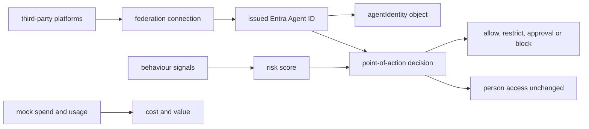

# Component: connected-platform Entra Agent IDs

Agents built outside this tenant still need an identity, a risk level and a reason to keep paying for
them. This component issues an Entra Agent ID to a third-party agent, recomputes a risk score from
behaviour signals, and answers the access decision at the point of action. A separate report compares
spend with value. It runs entirely on mocks. Preview product details are marked [verify]. The behaviour
follows the
[Agent 365 Ignite announcement](https://techcommunity.microsoft.com/blog/agent-365-blog/whats-new-in-microsoft-agent-365-ignite-2026/4571753).

Sections: [1. Purpose](#1-purpose) · [2. Architecture](#2-architecture) · [3. How it works](#3-how-it-works) · [4. Key files](#4-key-files) · [5. Code excerpts](#5-code-excerpts) · [6. Configuration](#6-configuration) · [7. Commands](#7-commands) · [8. Real output](#8-real-output) · [9. Tests and gates](#9-tests-and-gates) · [10. Guardrails](#10-guardrails) · [11. Security and governance](#11-security-and-governance) · [12. Observability](#12-observability) · [13. Failure modes](#13-failure-modes) · [14. Mapping to Azure services](#14-mapping-to-azure-services) · [15. Limitations](#15-limitations) · [16. Interview talking points](#16-interview-talking-points)

## 1. Purpose

* Give agents from Amazon Bedrock, Google, Salesforce, Databricks, Anthropic and OpenAI the same kind of
  identity the synthetic tenant already uses for Foundry agents.
* Recompute one risk level as new behaviour arrives, and turn that level into a conditional-access style
  response that does not touch the person's own access.
* Show which agents earn their spend.

## 2. Architecture



## 3. How it works

1. `connect` accepts a platform only with workload identity federation and an empty secret. A stored key
   is refused, so the registry never keeps one.
2. `issue` returns a deterministic Entra Agent ID, the agent's own app id, a blueprint id for that
   platform, and the owner's sponsor link. The same agent always gets the same id.
3. `as_service_principal` emits a Microsoft Graph `agentIdentity` object, the type `inventory.py` already
   classifies as an agent identity. `as_blueprint` emits the matching blueprint.
4. `assess` sums fixed signal weights, adds `ownerless` when there is no sponsor (once), and caps the
   score at 100. Levels are low below 25, medium from 25, high from 50, critical from 75.
5. `decide` runs only at the point of action. A write, or a tool in the sensitive set, is sensitive.
   Low routine work is allowed. Medium sensitive work waits for a person. High routine work continues
   in a reduced form. High sensitive work, and anything at critical, is blocked.
6. `outcome` describes the effect on the agent. The user's access stays `unchanged`, and nothing is
   written to a tenant.
7. `recommend` labels each agent invest, hold, review or retire from spend, assisted value, success and
   sessions. `forecast_spend` is a local scenario: invest grows by a quarter, retire goes to zero.

## 4. Key files

| File | Role |
|---|---|
| `src/idsec/agent365.py` | Registry, risk, decisions, cost report |
| `src/idsec/inventory.py` | Classifies `#microsoft.graph.agentIdentity` as `agent_identity` |
| `src/idsec/gate.py` | Release check that the six identities, the risk move and the report stay true |
| `tests/test_agent365.py` | Issuance, signals, decisions, recommendations |

## 5. Code excerpts

Issuing an identity refuses a stored secret by going through `connect`, then returns a stable id.

<!-- code: src/idsec/agent365.py::issue -->
```python
def issue(agent: ExternalAgent) -> IssuedIdentity:
    """Issue one Entra Agent ID for a third-party agent. The same agent always gets the same id."""
    connect(agent.platform, "workload-identity-federation")
    return IssuedIdentity(
        entra_agent_id=f"agentid-{agent.platform}-{agent.external_id}",
        platform=agent.platform,
        external_id=agent.external_id,
        name=agent.name,
        sponsors=(agent.owner,) if agent.owner else (),
        tools=agent.tools,
        app_id=f"app-{agent.platform}-{agent.external_id}",
        blueprint_id=f"blueprint-{agent.platform}",
        auth="workload-identity-federation",
        stored_secrets=0,
    )
```
<!-- /code -->

The decision is taken when the agent acts. A sign-in is not enough, and the person named in
`on_behalf_of` is not the subject of the block.

<!-- code: src/idsec/agent365.py::decide -->
```python
def decide(
    ident: IssuedIdentity,
    risk: Risk,
    operation: str,
    tool: str = "",
    *,
    on_behalf_of: str = "",
    when: str = "action",
) -> Decision:
    """Conditional-access style response at the point of action. The person's own access is not changed."""
    if when != "action":
        raise RegistryError("dynamic controls evaluate at the point of action, not only at sign-in")
    if risk.entra_agent_id != ident.entra_agent_id:
        raise RegistryError("risk was computed for a different agent")
    sensitivity = "sensitive" if operation == "write" or tool in SENSITIVE_TOOLS else "routine"
    response = RESPONSES[(risk.level, sensitivity)]
    shown = f"tool {tool}" if tool else operation
    return Decision(
        entra_agent_id=ident.entra_agent_id,
        agent=ident.name,
        operation=shown,
        sensitivity=sensitivity,
        risk_level=risk.level,
        risk_score=risk.score,
        response=response,
        ca_style=CA_STYLE[response],
        evaluated_at="action",
        on_behalf_of=on_behalf_of,
        user_access="unchanged",
        reason=f"risk {risk.level} ({risk.score}) on a {sensitivity} action; human access left as-is",
    )
```
<!-- /code -->

## 6. Configuration

All of it is in `src/idsec/agent365.py`: `PLATFORMS`, `SIGNAL_KINDS` and the level cuts, `SENSITIVE_TOOLS`,
`RESPONSES`, the fictional `CATALOG`, `OBSERVATIONS`, `FOLLOW_UP` and `USAGE`. Changing a weight or a cut
is a reviewed code change, same as the gate thresholds.

## 7. Commands

```bash
idsec agent365
```

## 8. Real output

<!-- output: agent365 -->
```text
Connected-platform Entra Agent IDs (synthetic Kestrel Ridge Mortgage)
Offline model of Agent 365 connected platforms, dynamic agent risk and cost against value.
Preview product behaviour this model does not copy exactly is marked [verify] in the docs.

Registry (one Entra Agent ID per third-party agent; stored secrets 0):
platform    agent                 entra agent id                     sponsor                            secrets
----------  --------------------  ---------------------------------  ---------------------------------  -------
bedrock     Loan document reader  agentid-bedrock-br-loan-reader     ava.chen@kestrelridge.example      0
google      Rate sheet assistant  agentid-google-gx-rate-sheet       kai.thompson@kestrelridge.example  0
salesforce  Collections outreach  agentid-salesforce-sf-collections  priya.nair@kestrelridge.example    0
databricks  Loss model explainer  agentid-databricks-db-loss-model   ava.chen@kestrelridge.example      0
anthropic   Policy drafter        agentid-anthropic-an-policy-draft  (none)                             0
openai      Ops copilot           agentid-openai-oa-ops-copilot      marcus.reid@kestrelridge.example   0

Dynamic risk (baseline, then Ops copilot after one new cloud signal):
agent                       score  level     signals
--------------------------  -----  --------  ------------------------------------------------------------------------
Loan document reader        10     low       code_or_model_update
Rate sheet assistant        0      low       -
Collections outreach        35     medium    sensitive_data, unexpected_network
Loss model explainer        40     medium    sensitive_data, high_blast_radius
Policy drafter              25     medium    ownerless
Ops copilot                 60     high      sensitive_tool, privilege_expansion, became_target
Ops copilot (after signal)  75     critical  sensitive_tool, privilege_expansion, became_target, anomalous_cloud_call

Access at the point of action (the person's own access stays unchanged):
agent                       action              on behalf of                      risk         response          control                       person
--------------------------  ------------------  --------------------------------  -----------  ----------------  ----------------------------  ---------
Loan document reader        read                ava.chen@kestrelridge.example     low 10       allow             grant allow                   unchanged
Rate sheet assistant        read                -                                 low 0        allow             grant allow                   unchanged
Collections outreach        tool send-email     priya.nair@kestrelridge.example   medium 35    require_approval  grant require human approval  unchanged
Loss model explainer        tool sql-warehouse  -                                 medium 40    require_approval  grant require human approval  unchanged
Policy drafter              read                -                                 medium 25    allow             grant allow                   unchanged
Policy drafter              write               -                                 medium 25    require_approval  grant require human approval  unchanged
Ops copilot                 tool role-assign    marcus.reid@kestrelridge.example  high 60      block             grant block                   unchanged
Ops copilot                 read                marcus.reid@kestrelridge.example  high 60      restrict          session reduced access        unchanged
Ops copilot (after signal)  read                marcus.reid@kestrelridge.example  critical 75  block             grant block                   unchanged

Cost and value (dollars are the mock ledger, not a bill):
agent                 sessions  hours  spend  value  ratio  success  satisfaction  recommendation  next spend
--------------------  --------  -----  -----  -----  -----  -------  ------------  --------------  ----------
Loan document reader  820       310    400    1600   4.0    0.91     0.88          invest          500
Rate sheet assistant  210       40     200    280    1.4    0.74     0.66          hold            200
Collections outreach  1400      500    900    2100   2.3    0.82     0.77          hold            900
Loss model explainer  90        60     1100   4400   4.0    0.90     0.84          invest          1375
Policy drafter        48        15     640    180    0.3    0.41     0.38          retire          0
Ops copilot           260       80     2100   700    0.3    0.52     0.40          retire          0

spend 5340  assisted value 9260  next spend if recommendations are followed 2975
invest 2  hold 2  retire 2
identities 6  unique 6  stored secrets 0
ops copilot risk 60 high -> 75 critical
```
<!-- /output -->

## 9. Tests and gates

`tests/test_agent365.py` covers issuance, secret refusal, the Graph shape, ownerless counted once,
reweighted signals, the level cuts, every demo decision, sign-in refusal, and the cost boundaries.
`idsec gate` fails if the six identities are missing, a secret is stored, Ops copilot's score does not
rise, a response is wrong, the person's access changes, or a decision is written to a tenant.

## 10. Guardrails

* No network call and no secret stored on a connection.
* A caller cannot pass a custom signal weight.
* `require_approval` and `block` do not proceed; `restrict` is reduced access, not a silent allow of a
  sensitive tool.
* The person's own access is a different decision and is left unchanged.
* The cost figures are a mock ledger. The report says they are not a bill.

## 11. Security and governance

An agent without its own identity is hard to tell apart from the person who built it. The issued
identity is the handle for a sponsor, a blueprint and a later revoke. Secretless federation removes a
long-lived key from the connection. Risk is recomputed when a new signal arrives, so a routine read can
continue while a sensitive tool call is held or blocked. An ownerless agent starts at medium because
nobody is accountable for it.

## 12. Observability

Each decision records the score, the level, the sensitivity, the response, the conditional-access style
control name used here, and that it was evaluated at the action. The report lists the signals that
produced the score, including the extra cloud signal on Ops copilot.

## 13. Failure modes

| Failure | Effect | Handling |
|---|---|---|
| A platform connection includes a stored key | That key would have to be stored and rotated | `connect` raises; no identity is issued from it |
| A caller supplies a signal weight | The score can be laundered | `assess` rejects unknown or reweighted signals |
| Blocking the agent also locks the person | The employee cannot work | `user_access` stays `unchanged` |
| The forecast is treated as an invoice | Budget decisions on a mock | The report labels the ledger as not a bill |

## 14. Mapping to Azure services

| Here | In Azure |
|---|---|
| Issued identity and blueprint | **Entra Agent ID** objects in **Entra ID**, read through **Microsoft Graph** as `agentIdentity` and `agentIdentityBlueprint` |
| Point-of-action response | **Entra ID** Conditional Access, evaluated when the agent acts, separate from the person's policies |
| Sponsor accountability | The sponsor relationship already used for Foundry agents; standing admin rights stay in **PIM** |
| Risk level shown beside the agent | The announcement describes the same level in the admin center, Defender, Entra and Purview [verify] |
| Workload tokens for **Foundry** agents | Already modelled by the 28 rules; this pack does not rescore those agents |

**Defender for Cloud** is not called. This pack does not replace Defender's agent inventory or a live
Conditional Access policy.

## 15. Limitations

* Signal weights and the cuts at 25, 50 and 75 are this repository's model. The product's formula is not
  published here [verify].
* The announcement names further platforms, including Snowflake, Amazon AgentCore, Oracle, SAP,
  ServiceNow and UiPath, and says support finishes later [verify]. This model covers the six platforms
  above.
* Secretless federation is a hard refusal of stored secrets. The announcement says that applies to
  supported connections and that capabilities vary by platform [verify].
* The four responses stand in for Conditional Access grant and session controls. The Graph schema for
  those dynamic controls is not copied [verify].
* The same risk level is only printed here. The announcement says it also appears in the Microsoft 365
  admin center, Defender, Entra and Purview [verify].
* Assisted value, success, satisfaction and the forecast are a fixed ledger and a four-way rule. The
  product's definitions and licensing are not reproduced [verify].
* Sponsors are fictional email addresses, not directory object ids [verify].
* Foundry agents already in the synthetic tenant keep the existing rules. This pack does not feed its
  identities back into `idsec scan`, so the 28-rule scores stay stable.

## 16. Interview talking points

* "A third-party agent without an Entra Agent ID is invisible to the same identity controls as a Foundry
  agent. The registry is how it gets one, without a stored key."
* "Risk moves when the agent does something new. The decision is at the action, so a read can continue
  while a role assignment is blocked, and the employee's own sign-in is a different policy."
* "Spend without value is just spend. Two of the six agents are labelled retire because assisted value
  is below what they cost and people are still using them."
