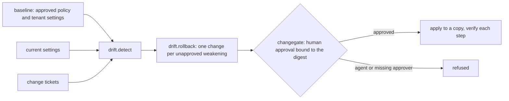

# Component: configuration drift and approved rollback

Conditional Access and tenant settings drift: a policy is switched to report-only "for a day", an
exclusion group grows, guest invitations open up. This component compares the live settings with an
approved baseline, separates changes that have a ticket from changes that weaken security without one,
and proposes a rollback for each unapproved weakening. A rollback runs only after a configured person
approves it, and an admin-protecting policy needs two people.

Sections: [1. Purpose](#1-purpose) · [2. Architecture](#2-architecture) · [3. How it works](#3-how-it-works) · [4. Key files](#4-key-files) · [5. Code excerpts](#5-code-excerpts) · [6. Configuration](#6-configuration) · [7. Commands](#7-commands) · [8. Real output](#8-real-output) · [9. Tests and gates](#9-tests-and-gates) · [10. Guardrails](#10-guardrails) · [11. Security and governance](#11-security-and-governance) · [12. Observability](#12-observability) · [13. Failure modes](#13-failure-modes) · [14. Mapping to Azure services](#14-mapping-to-azure-services) · [15. Limitations](#15-limitations) · [16. Interview talking points](#16-interview-talking-points)

## 1. Purpose

* Catch every change against the baseline and say which direction it moved (weaker or stronger).
* Turn unapproved weakening into a rollback that a person approves; never roll back on an agent's say-so.
* Prove after the change that the setting is back where the baseline says.

## 2. Architecture



## 3. How it works

1. `baseline()` flattens the four Conditional Access policies and three tenant settings into keys.
2. `current()` applies six synthetic changes: some weaken, some strengthen, one has a ticket.
3. `detect` compares key by key, marks direction, and attaches a ticket when one exists.
4. `rollback` builds one `changegate.Change` per unapproved weakening. Changes to a policy that protects
   admins are dual control.
5. The walkthrough shows an agent trying to approve (refused), one approver (dual-control change refused),
   then a second approver, and re-runs `detect` to confirm nothing unapproved is left.

## 4. Key files

| File | Role |
|---|---|
| `src/idsec/drift.py` | Baseline, detection, rollback proposals, walkthrough and evaluation |
| `src/idsec/changegate.py` | Approvals bound to a change digest, dual control, simulated apply and verification |
| `config/approvers.yaml` | The people who may approve |
| `tests/test_posture_packs.py` | Change gate and drift tests |

## 5. Code excerpts

<!-- code: src/idsec/changegate.py::apply -->
```python
def apply(change: Change, approvals: list[Approval], state: dict) -> tuple[Result, dict]:
    """Apply to a copy of `state` only when approvals match; return the result and the new state."""
    mine = [a for a in approvals if a.change_id == change.id]
    if any(a.digest != change.digest for a in mine):
        return Result(change.id, "refused", "an approval was for a different version of this change"), state
    people = {a.approver for a in mine}
    need = 2 if change.dual_control else 1
    if len(people) < need:
        return Result(change.id, "refused", f"needs {need} distinct human approver(s), has {len(people)}"), state
    new = copy.deepcopy(state)
    for s in change.steps:
        _set(new, s.key, s.value)
    checks = [(s.key, _get(new, s.key) == s.value) for s in change.steps]
    return Result(change.id, "applied", "simulated state only; nothing was changed in a tenant", checks), new
```
<!-- /code -->

<!-- code: src/idsec/drift.py::rollback -->
```python
def rollback(drifts: list[Drift]) -> list[changegate.Change]:
    return [
        changegate.Change(
            f"RB-{i:02d}",
            f"restore {d.key} to the approved baseline",
            [changegate.Step(d.key, d.before, f"changed without a ticket ({d.before!r} -> {d.after!r})")],
            dual_control=d.protects_admins,
        )
        for i, d in enumerate([d for d in drifts if d.action == "rollback"], 1)
    ]
```
<!-- /code -->

## 6. Configuration

Approvers come from `config/approvers.yaml`. Identities that start with `agent:`, `sp:` or `mcp:` can
never approve, whatever the file says. Tickets are listed in `drift.TICKETS`.

## 7. Commands

```bash
idsec drift
```

## 8. Real output

<!-- output: drift -->
```text
Configuration drift against the approved baseline (synthetic Kestrel Ridge Mortgage)

  rollback            ca.CA01.excludeUsers: [] -> ['00000000-0000-0000-0001-00000000000b'] (weakening, no ticket)
  strengthening       ca.CA02.state: 'enabledForReportingButNotEnforced' -> 'enabled' (strengthening, ticket CHG-1042)
  rollback            ca.CA03.state: 'enabled' -> 'enabledForReportingButNotEnforced' (weakening, no ticket)
  cosmetic            ca.CA04.displayName: 'CA04 Require MFA for guests (pilot)' -> 'CA04 Require MFA for guests (pilot, renamed)' (cosmetic, no ticket)
  approved-weakening  settings.guestInvite: 'adminsOnly' -> 'everyone' (weakening, ticket CHG-1047)
  rollback            settings.userConsent: 'none' -> 'all-apps' (weakening, no ticket)

Rollback proposals (each needs a human approval bound to its digest):
  RB-01 restore ca.CA01.excludeUsers to the approved baseline  digest 96f7ffad308240c7  one approver
  RB-02 restore ca.CA03.state to the approved baseline  digest 1dfe260a7ae7e462  dual control
  RB-03 restore settings.userConsent to the approved baseline  digest 185c15277bb20725  one approver
  agent tried to approve RB-01: refused
  RB-01 with one approver: applied
  RB-02 with one approver: refused (needs 2 distinct human approver(s), has 1)
  RB-03 with one approver: applied
  RB-02 with two approvers: applied

Measured (synthetic changes, labelled):
  drifts: 6
  classified_correctly: 6/6
  rollbacks_proposed: 3
  refused_with_one_approver: 1
  applied_after_approval: 3
  verification_passed: True
  unapproved_weakening_left: 0
  agent_approval_refused: True
```
<!-- /output -->

## 9. Tests and gates

`tests/test_posture_packs.py` covers this pack; `idsec gate` adds a release check for it (see [metrics and release gate](metrics-gate.md)). The tests cover agent and unknown approvers, an
approval for an edited change (refused), dual control, that `apply` never mutates its input, and that a
ticketed change is left alone.

## 10. Guardrails

* No rollback without a configured human; dual control on admin-protecting policies.
* An approval covers one exact version of a change (its digest); editing the change voids it.
* `apply` works on an in-memory copy and reports a verification for every step.

## 11. Security and governance

Drift detection is read-only. The rollback is a proposal; in a real tenant it would be a Microsoft Graph
`PATCH` on the policy, issued by a separate, approved pipeline, never by this tool.

## 12. Observability

Each drift line shows key, before, after, direction and ticket. Each change shows its digest and how many
approvers it needs, so an audit can match approval to change.

## 13. Failure modes

| Failure | Effect | Handling |
|---|---|---|
| A change has no ticket but was agreed verbally | It is proposed for rollback | The approver declines; add the ticket |
| An approver is on leave | Dual-control change waits | A second configured approver signs |
| Baseline is stale | Intended changes look like drift | Update the baseline through review |

## 14. Mapping to Azure services

| Here | In Azure |
|---|---|
| Baseline keys | **Entra ID** Conditional Access policies and authorization policy, read with **Microsoft Graph** |
| Rollback | A Graph `PATCH`, run by an approved pipeline |
| Approvers | Named people, ideally holding the role through **PIM** just in time |

Agent identities from **Entra Agent ID** and any **Foundry** agent can propose but never approve. **Defender for Cloud** is not involved; it covers Azure resources, not tenant settings.

## 15. Limitations

* Six synthetic changes and three settings; a real tenant has many more keys.
* Direction (weaker or stronger) is decided by a small table of known settings.

## 16. Interview talking points

* "Drift detection is easy; the hard part is knowing which changes were approved, so tickets are part of the input."
* "The approval is bound to a digest, so nobody can approve one change and run another."
