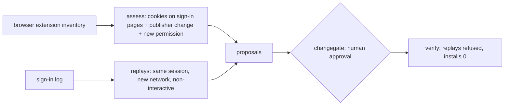

# Component: malicious browser extension and session cookie theft

A popular extension changes publisher, and its next update asks for cookies on the Microsoft sign-in pages.
Soon after, three users' sessions are replayed from a network none of them used, with no MFA prompt. This
component finds the extension, ties the replays to it, and proposes two changes: revoke the affected users'
sessions and block the extension for the whole organization. Both wait for a human; neither is ever
approved by an agent; both are verified afterwards.

Sections: [1. Purpose](#1-purpose) · [2. Architecture](#2-architecture) · [3. How it works](#3-how-it-works) · [4. Key files](#4-key-files) · [5. Code excerpts](#5-code-excerpts) · [6. Configuration](#6-configuration) · [7. Commands](#7-commands) · [8. Real output](#8-real-output) · [9. Tests and gates](#9-tests-and-gates) · [10. Guardrails](#10-guardrails) · [11. Security and governance](#11-security-and-governance) · [12. Observability](#12-observability) · [13. Failure modes](#13-failure-modes) · [14. Mapping to Azure services](#14-mapping-to-azure-services) · [15. Limitations](#15-limitations) · [16. Interview talking points](#16-interview-talking-points)

## 1. Purpose

* Detect the extension from its permissions and history, not from a known-bad list.
* Respond in two approved steps and prove they worked: replayed sessions refused, no device still running it.

## 2. Architecture



## 3. How it works

1. `assess` flags an extension that can read cookies on sign-in hosts and has at least two warning signs
   (publisher change, cookies permission newly added); a reviewed allowlist entry is not flagged.
2. `replays` finds non-interactive use of a session from a different network than it was issued on.
3. `proposals` builds EXT-01 (revoke sessions for replayed users with the extension) and EXT-02 (blocklist
   and force-remove the extension).
4. The walkthrough applies both without approval (refused), lets an agent try (refused), then a person approves.

## 4. Key files

| File | Role |
|---|---|
| `src/idsec/extension.py` | Inventory, assessment, replay detection, proposals, walkthrough, evaluation |
| `src/idsec/changegate.py` | Approval and verification |

## 5. Code excerpts

<!-- code: src/idsec/extension.py::assess -->
```python
def assess(ext: dict) -> Verdict:
    new = ext["versions"][-1]
    old = ext["versions"][-2] if len(ext["versions"]) > 1 else None
    reads_cookies = "cookies" in new["permissions"]
    login = [h for h in new["hosts"] if any(x in h for x in LOGIN_HOSTS)]
    reasons = []
    if reads_cookies and login:
        reasons.append("can read cookies on sign-in pages")
    if old and old["publisher"] != new["publisher"]:
        reasons.append(f"publisher changed ({old['publisher']} -> {new['publisher']})")
    if old and "cookies" in new["permissions"] and "cookies" not in old["permissions"]:
        reasons.append("cookies permission added in the latest update")
    risky = bool(reads_cookies and login) and ext["id"] not in ALLOWLIST and len(reasons) >= 2
    return Verdict(ext["id"], ext["name"], risky, reasons if risky else (["allowlisted after review"] if ext["id"] in ALLOWLIST else reasons))
```
<!-- /code -->

## 6. Configuration

`LOGIN_HOSTS` and `ALLOWLIST` are constants. Network numbers are documentation-range ASNs.

## 7. Commands

```bash
idsec extension
```

## 8. Real output

<!-- output: extension -->
```text
Malicious browser extension and session cookie theft (synthetic)

Extension review:
  RISKY PDF Quick Convert (23 installs): can read cookies on sign-in pages; publisher changed (Quickdoc Tools -> QD Labs Ltd); cookies permission added in the latest update
  ok    Vaultkeeper Password Manager (61 installs): allowlisted after review
  ok    CleanPage Ad Blocker (40 installs): no cookie access to sign-in pages

Session replays (non-interactive, new network, no MFA):
  sara.okafor@kestrelridge.example session s-sara-1 from AS64511
  devon.lee@kestrelridge.example session s-devon-1 from AS64511
  mia.santos@kestrelridge.example session s-mia-1 from AS64511

Proposed changes (each needs a human approval bound to its digest):
  EXT-01 revoke sign-in sessions for 3 user(s) whose sessions were replayed  digest 10cf61c9a65d6c79
  EXT-02 block and remove PDF Quick Convert for the whole organization  digest 0d68f8162e21d48b
  EXT-01 no approval: refused
  EXT-02 no approval: refused
  EXT-01 agent approval: refused
  EXT-01 approved by ava.chen: applied
  EXT-02 approved by ava.chen: applied

Measured (synthetic, labelled):
  extensions_reviewed: 3
  risky_correct: True
  look_alike_extensions_flagged: 0
  replayed_users_found: 3/3
  fresh_mfa_travel_flagged: False
  changes_without_approval: 0
  agent_approval_refused: True
  applied_after_approval: 2
  verification_passed: True
  replays_still_accepted: 0
  devices_still_running_extension: 0
```
<!-- /output -->

## 9. Tests and gates

`tests/test_posture_packs.py` covers this pack; `idsec gate` adds a release check for it (see [metrics and release gate](metrics-gate.md)). Tests cover the allowlisted cookie reader, an extension without sign-in host access, same-network reuse and the org-wide scope.

## 10. Guardrails

* Session revocation and the organization-wide block are separate changes, each needing approval.
* A traveller who signs in fresh with MFA is not treated as a replay.

## 11. Security and governance

Revoking sessions signs users out everywhere; that cost is why a person decides.

## 12. Observability

The report lists every extension with its reasons, every replay, and each change with its digest and outcome.

## 13. Failure modes

| Failure | Effect | Handling |
|---|---|---|
| Extension inventory is missing for unmanaged browsers | Theft from a personal device is missed | App-enforced restrictions limit what that device can reach |
| Attacker replays from the same network | Not detected by this rule | Token protection binds the token to the device |

## 14. Mapping to Azure services

| Here | In Azure |
|---|---|
| Session revocation | **Entra ID** `revokeSignInSessions` through **Microsoft Graph**, run by an approved pipeline |
| Extension block | Managed browser policy (blocklist and force-remove) through Intune |
| Approver role | Held through **PIM** |

A **Foundry** or **Entra Agent ID** responder agent can prepare both changes but cannot approve them. **Defender for Cloud** is not involved; endpoint telemetry would come from Defender for Endpoint.

## 15. Limitations

* Three extensions, nine sign-ins; the scenario is a story, not a detection-rate claim.

## 16. Interview talking points

* "MFA was never broken here; the session was copied. The fix is shorter, device-bound sessions and a human-approved revoke."
