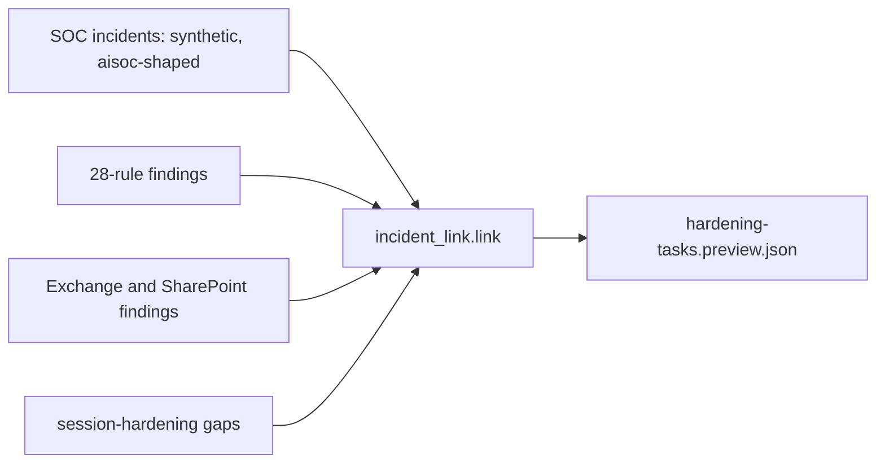

# Component: SOC incident to hardening task

When the companion SOC (Jagadish-azure-ai-soc) confirms an incident, the next question is what let it
happen. This component links each true-positive incident to the posture findings that explain it (by the
accounts it names and the ATT&CK techniques it used) and writes one hardening task per link to a preview
file. Benign incidents create no tasks, and nothing is sent anywhere.

Sections: [1. Purpose](#1-purpose) · [2. Architecture](#2-architecture) · [3. How it works](#3-how-it-works) · [4. Key files](#4-key-files) · [5. Code excerpts](#5-code-excerpts) · [6. Configuration](#6-configuration) · [7. Commands](#7-commands) · [8. Real output](#8-real-output) · [9. Tests and gates](#9-tests-and-gates) · [10. Guardrails](#10-guardrails) · [11. Security and governance](#11-security-and-governance) · [12. Observability](#12-observability) · [13. Failure modes](#13-failure-modes) · [14. Mapping to Azure services](#14-mapping-to-azure-services) · [15. Limitations](#15-limitations) · [16. Interview talking points](#16-interview-talking-points)

## 1. Purpose

* Close the loop between detection and prevention.
* Keep the links reviewable: each task says why it was linked.

## 2. Architecture



## 3. How it works

1. Only `true_positive` incidents are linked.
2. A finding links when it names an incident entity, or when its rule's techniques match and it is a
   tenant-wide setting (the legacy-authentication policy).
3. Inbox-rule incidents link to Exchange findings for the same account; stolen-session incidents link to
   each open session-hardening gap.

## 4. Key files

| File | Role |
|---|---|
| `src/idsec/incident_link.py` | Incidents, linking, evaluation and the preview writer |
| `src/idsec/soc.py` | The opposite direction: findings exported as SOC alerts |

## 5. Code excerpts

<!-- code: src/idsec/incident_link.py::link -->
```python
def link(incidents: list[dict] | None = None) -> list[Task]:
    incidents = incidents or INCIDENTS
    fs = _findings()
    mfind = m365.scan()
    sess = [r for r in session.check(session.tenant_policies()) if r.status != "pass"]
    tasks: list[Task] = []
    for inc in incidents:
        if inc["verdict"] != "true_positive":
            continue
        ents = set(inc["entities"])
        techs = set(inc["techniques"])
        for f in fs:
            meta = detections.rule_meta(f.rule)
            named = f.label in ents or f.label.split(":")[0] in ents
            tech = bool(techs & set(meta.get("attack", [])))
            if named or (tech and f.rule in TENANT_WIDE):
                why = "names " + f.label if named else "technique " + ", ".join(sorted(techs & set(meta["attack"])))
                tasks.append(Task("", inc["id"], f.id, why, meta["fix"]))
        for t in techs & set(TECH_TO_M365):
            for mf in mfind:
                if mf.check in TECH_TO_M365[t] and any(e in mf.detail for e in ents):
                    tasks.append(Task("", inc["id"], f"M365:{mf.obj}", f"technique {t}; {mf.detail}", mf.fix))
        if techs & TECH_TO_SESSION:
            for r in sess:
                tasks.append(
                    Task(
                        "",
                        inc["id"],
                        f"SESSION:{r.check}",
                        "stolen session; " + r.meaning + " is not enforced",
                        "enforce the proposed report-only policy after the impact review",
                    )
                )
    for i, t in enumerate(tasks, 1):
        t.id = f"HT-{i:03d}"
    return tasks
```
<!-- /code -->

## 6. Configuration

The incident list is synthetic and lives in `incident_link.INCIDENTS`. `--out DIR` writes the preview.

## 7. Commands

```bash
idsec incident-link --out out/
```

## 8. Real output

<!-- output: incident-link -->
```text
SOC incident -> hardening tasks (synthetic incidents; preview only, nothing sent)

INC-2041 Password spray over IMAP, one success [true_positive]
  HT-001 -> P02-01  (names gary.holt@kestrelridge.example)
  HT-002 -> F03-01  (names gary.holt@kestrelridge.example)
  HT-003 -> F05-01  (technique T1110.003)
INC-2043 New inbox rule forwards mail to a free-mail address [true_positive]
  HT-004 -> F01-01  (names leo.martins@kestrelridge.example)
  HT-005 -> M365:RULE-01  (technique T1114.003; leo.martins@kestrelridge.example -> leo.m.personal@freemail.example (rule name '..'))
  HT-006 -> M365:MBX-04  (technique T1114.003; leo.martins@kestrelridge.example: audit off)
INC-2047 Session cookie replayed from a new network [true_positive]
  HT-007 -> F02-01  (names sara.okafor@kestrelridge.example)
  HT-008 -> SESSION:sign-in-frequency-sensitive-apps  (stolen session; sensitive apps re-authenticate at least every 8 hours is not enforced)
  HT-009 -> SESSION:no-persistent-browser-unmanaged  (stolen session; unmanaged browsers cannot keep a persistent session is not enforced)
  HT-010 -> SESSION:token-protection-or-strict-cae  (stolen session; mail and file tokens are device-bound or revoked in near real time is not enforced)
  HT-011 -> SESSION:app-enforced-restrictions-byod  (stolen session; unmanaged devices get limited, browser-only access to mail and files is not enforced)
INC-2050 Consent granted to an unverified mail archiver [true_positive]
  HT-012 -> P08-01  (names MailVault Archiver)
INC-2052 Help-desk agent called a role-assignment tool after reading a ticket [true_positive]
  HT-013 -> E07-03  (names it-helpdesk)
  HT-014 -> E13-01  (names it-helpdesk)
INC-2055 Impossible travel (corporate VPN egress) [benign]
  no hardening task (benign)

Measured against reviewer-agreed links:
  incidents: 6
  true_positive_incidents: 5
  tasks: 14
  precision: 1.0
  recall: 1.0
  benign_incidents_with_tasks: 0
  sent: 0
```
<!-- /output -->

## 9. Tests and gates

`tests/test_posture_packs.py` covers this pack; `idsec gate` adds a release check for it (see [metrics and release gate](metrics-gate.md)). Tests cover the benign incident, an unknown entity, task numbering and the preview file.

## 10. Guardrails

* Preview file only: no ticket is created and no message is sent.
* Incident free text is never copied into tasks; only ids, entity names and rule fixes are.

## 11. Security and governance

The link is two-way: the task carries the incident id, and the finding id points back to the posture report.

## 12. Observability

Each task prints the reason it was linked (entity named or technique).

## 13. Failure modes

| Failure | Effect | Handling |
|---|---|---|
| An incident names an alias | No link | Normalize entities to the user principal name in the SOC |
| Too many tasks for one tenant-wide gap | Duplicates | Group tasks per finding before raising them |

## 14. Mapping to Azure services

| Here | In Azure |
|---|---|
| Incidents | Microsoft Sentinel incidents in the companion repository |
| Findings | **Entra ID**, **PIM**, **Microsoft Graph** and **Entra Agent ID** posture from this repository |

**Foundry** agent findings link the same way (for example the help-desk agent). **Defender for Cloud** recommendations could be added as another source.

## 15. Limitations

* Six synthetic incidents; the link rules are simple and explainable rather than learned.

## 16. Interview talking points

* "Every confirmed incident should leave the tenant harder to attack in the same way."
