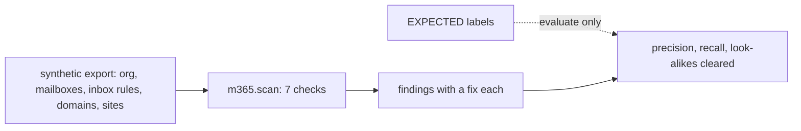

# Component: Exchange Online and SharePoint posture

After an account is taken over, attackers forward mail out, rely on mailboxes that are not audited, send with
plain passwords over SMTP, spoof sister domains and share files anonymously. Seven checks over a synthetic
configuration export find those settings, and five look-alikes (an internal forward, an approved partner
forward, a documented scanner exception, a parked domain and a public marketing site) must stay clear.

Sections: [1. Purpose](#1-purpose) · [2. Architecture](#2-architecture) · [3. How it works](#3-how-it-works) · [4. Key files](#4-key-files) · [5. Code excerpts](#5-code-excerpts) · [6. Configuration](#6-configuration) · [7. Commands](#7-commands) · [8. Real output](#8-real-output) · [9. Tests and gates](#9-tests-and-gates) · [10. Guardrails](#10-guardrails) · [11. Security and governance](#11-security-and-governance) · [12. Observability](#12-observability) · [13. Failure modes](#13-failure-modes) · [14. Mapping to Azure services](#14-mapping-to-azure-services) · [15. Limitations](#15-limitations) · [16. Interview talking points](#16-interview-talking-points)

## 1. Purpose

* Cover the mail and file settings that matter most after an identity compromise.
* Measure against labelled answers, with look-alikes that a naive check would flag.

## 2. Architecture



## 3. How it works

1. Inbox rules forwarding or redirecting outside the company, unless they carry an approval.
2. Mailboxes with auditing off or bypassed.
3. SMTP AUTH on for the organization.
4. Domains without DKIM or with DMARC `p=none` (a parked domain with no MX and `p=reject` is fine).
5. Anonymous links on non-public sites without a short expiry; anonymous default link type; guests that never expire.

## 4. Key files

| File | Role |
|---|---|
| `src/idsec/m365.py` | Export, checks, fixes, labels and evaluation |

## 5. Code excerpts

<!-- code: src/idsec/m365.py::scan -->
```python
def scan(cfg: dict | None = None) -> list[Finding]:
    cfg = cfg or CONFIG
    ex, sp = cfg["exchange"], cfg["sharepoint"]
    out: list[Finding] = []
    for r in ex["inboxRules"]:
        dest = r.get("ForwardTo") or r.get("RedirectTo")
        if dest and _external(dest) and not r.get("approval"):
            out.append(Finding("external-forwarding", r["id"], f"{r['mailbox']} -> {dest} (rule name {r['name']!r})"))
    for m in ex["mailboxes"]:
        if ex["org"]["AuditDisabled"] or not m["AuditEnabled"] or m["AuditBypass"]:
            out.append(Finding("mailbox-audit", m["id"], f"{m['upn']}: audit {'bypassed' if m['AuditBypass'] else 'off'}"))
    if not ex["org"]["SmtpClientAuthenticationDisabled"]:
        out.append(Finding("smtp-auth", "ORG", "SMTP AUTH is on for every mailbox"))
    for d in ex["domains"]:
        if d.get("parked") and not d["mx"] and d["dmarc"] == "reject":
            continue
        if not d["dkim"] or d["dmarc"] in (None, "none"):
            out.append(Finding("domain-spoofing", d["id"], f"{d['name']}: DKIM {'on' if d['dkim'] else 'off'}, DMARC p={d['dmarc']}"))
    for s in sp["sites"]:
        if s["SharingCapability"] == "ExternalUserAndGuestSharing" and s["sensitivity"] != "Public":
            if s["anyoneLinkExpiryDays"] is None or s["anyoneLinkExpiryDays"] > 7:
                out.append(Finding("anyone-links", s["id"], f"{s['url']} ({s['sensitivity']}): anonymous links, expiry {s['anyoneLinkExpiryDays']}"))
    t = sp["tenant"]
    if t["DefaultSharingLinkType"] == "AnonymousAccess":
        out.append(Finding("default-link-anonymous", "TENANT", "new sharing links default to anyone with the link"))
    if not t["ExternalUserExpirationRequired"]:
        out.append(Finding("guest-expiry", "TENANT", "guest access never expires"))
    return out
```
<!-- /code -->

## 6. Configuration

`INTERNAL` lists the company's domains; `FIX` holds one plain-language fix per check.

## 7. Commands

```bash
idsec m365
```

## 8. Real output

<!-- output: m365 -->
```text
Exchange Online and SharePoint posture (synthetic Kestrel Ridge Mortgage export)

  [external-forwarding] RULE-01: leo.martins@kestrelridge.example -> leo.m.personal@freemail.example (rule name '..')
      fix: remove the rule and turn off automatic external forwarding in the outbound policy; check the mailbox for takeover
  [external-forwarding] RULE-04: gary.holt@kestrelridge.example -> archive.gh@mailbox-host.example (rule name 'x')
      fix: remove the rule and turn off automatic external forwarding in the outbound policy; check the mailbox for takeover
  [mailbox-audit] MBX-02: svc.reports@kestrelridge.example: audit bypassed
      fix: turn auditing on and remove the audit bypass
  [mailbox-audit] MBX-04: leo.martins@kestrelridge.example: audit off
      fix: turn auditing on and remove the audit bypass
  [smtp-auth] ORG: SMTP AUTH is on for every mailbox
      fix: turn SMTP AUTH off for the organization; keep per-mailbox exceptions with a ticket
  [domain-spoofing] DOM-02: kestrelridge-loans.example: DKIM off, DMARC p=none
      fix: publish DKIM and move DMARC to quarantine, then reject
  [anyone-links] SITE-01: /sites/LoanFiles (Confidential): anonymous links, expiry None
      fix: turn off anonymous links on confidential sites or require expiry of 7 days or less
  [default-link-anonymous] TENANT: new sharing links default to anyone with the link
      fix: set the default link type to people in the organization
  [guest-expiry] TENANT: guest access never expires
      fix: require guest access to expire (for example 60 days)

Cleared look-alikes: RULE-02 internal forward, RULE-03 approved partner forward (CHG-1051),
  MBX-03 scanner SMTP exception (EXC-311, still counted under the org-wide SMTP finding), DOM-03 parked domain with DMARC reject,
  SITE-02 public marketing site with 7-day links

Measured against the labelled export:
  checks: 7
  findings: 9
  expected: 9
  true_positives: 9
  false_positives: 0
  missed: 0
  precision: 1.0
  recall: 1.0
  look_alikes_cleared: 5/5
```
<!-- /output -->

## 9. Tests and gates

`tests/test_posture_packs.py` covers this pack; `idsec gate` adds a release check for it (see [metrics and release gate](metrics-gate.md)). Tests include a fully fixed configuration that must produce no findings.

## 10. Guardrails

* Read-only. Fixes are text for a person to apply.
* Labels are read only by `evaluate`.

## 11. Security and governance

External forwarding is both a data-loss and a takeover signal, so its fix says to check the mailbox too.

## 12. Observability

Each finding names the object (rule, mailbox, domain, site) so it can be found in the admin center.

## 13. Failure modes

| Failure | Effect | Handling |
|---|---|---|
| A partner forward has no approval recorded | It is flagged | Record the approval on the rule |
| The export is partial | Missed findings | Export all mailboxes and sites |

## 14. Mapping to Azure services

| Here | In Azure |
|---|---|
| Export | Exchange Online and SharePoint settings; inbox rules and audit state can also be read with **Microsoft Graph** |
| Accounts | **Entra ID** users; admin changes through **PIM** |

**Entra Agent ID** agents and **Foundry** agents with mail or file permissions are covered by the agent rules elsewhere in this repository. **Defender for Cloud** does not cover these settings.

## 15. Limitations

* A small synthetic export; precision and recall of 1.0 are a regression check, not an accuracy claim.

## 16. Interview talking points

* "Inbox forwarding to a free-mail address is the first thing I check after an identity alert."
