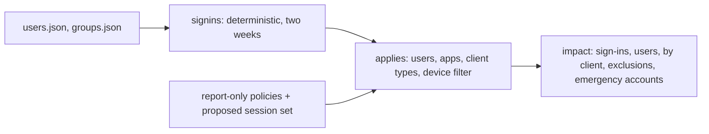

# Component: report-only impact (who would this block)

Before a Conditional Access policy is switched from report-only to on, an admin needs to know who it would
block or change. This component replays two weeks of synthetic sign-ins for every enabled account through
each report-only policy and lists the people, apps and clients affected, the exclusions that are in use, and
whether an emergency (break-glass) account is in scope.

Sections: [1. Purpose](#1-purpose) · [2. Architecture](#2-architecture) · [3. How it works](#3-how-it-works) · [4. Key files](#4-key-files) · [5. Code excerpts](#5-code-excerpts) · [6. Configuration](#6-configuration) · [7. Commands](#7-commands) · [8. Real output](#8-real-output) · [9. Tests and gates](#9-tests-and-gates) · [10. Guardrails](#10-guardrails) · [11. Security and governance](#11-security-and-governance) · [12. Observability](#12-observability) · [13. Failure modes](#13-failure-modes) · [14. Mapping to Azure services](#14-mapping-to-azure-services) · [15. Limitations](#15-limitations) · [16. Interview talking points](#16-interview-talking-points)

## 1. Purpose

* Answer "who would this block?" before anyone enforces a policy.
* Catch the surprise: in the synthetic tenant, the two accounts excused from MFA for a scan-to-email device
  would be blocked by the legacy-authentication policy, because that policy does not share the exclusion.

## 2. Architecture



## 3. How it works

1. `signins()` makes browser, desktop and phone sign-ins per account, Payroll sign-ins for Finance, IMAP
   and ActiveSync for three named accounts, and SMTP AUTH for the scanner exception group.
2. `applies` evaluates one policy against one sign-in: user scope and exclusions, application, client app
   type and the unmanaged-device filter.
3. `impact` aggregates per policy; `report` prints the people a block would stop.

## 4. Key files

| File | Role |
|---|---|
| `src/idsec/impact.py` | Sign-in replay, policy evaluation and the report |
| `src/idsec/session.py` | The proposed session-hardening policies that are also replayed |
| `data/tenant/graph/users.json` | Accounts (synthetic) |
| `data/tenant/graph/groups.json` | Exclusion groups (synthetic) |

## 5. Code excerpts

<!-- code: src/idsec/impact.py::applies -->
```python
def applies(p: dict, s: SignIn, member_of: set[str]) -> tuple[bool, str]:
    c = p["conditions"]
    u = c["users"]
    if s.user in u.get("excludeUsers", []) or member_of & set(u.get("excludeGroups", [])):
        return False, "excluded"
    inc = u.get("includeUsers", [])
    if not ("All" in inc or s.user in inc or ("GuestsOrExternalUsers" in inc and s.guest) or member_of & set(u.get("includeGroups", []))):
        return False, "not in scope"
    apps = c["applications"]["includeApplications"]
    if "All" not in apps and s.app not in apps:
        return False, "other app"
    types = c.get("clientAppTypes", ["all"])
    if "all" not in types and s.client not in types:
        return False, "other client"
    if c.get("devices") == session.UNMANAGED and s.compliant:
        return False, "managed device"
    return True, "applies"
```
<!-- /code -->

## 6. Configuration

The legacy clients are listed in `impact.LEGACY`. Policies come from the synthetic tenant (those in
`enabledForReportingButNotEnforced`) plus `session.proposed()`.

## 7. Commands

```bash
idsec impact
```

## 8. Real output

<!-- output: impact -->
```text
Who would this affect? Report-only replay of 373 synthetic sign-ins over two weeks

CA02 Block legacy authentication  [block]
  24 sign-in(s), 5 user(s); by client: {'IMAP mail client': 8, 'SMTP AUTH (scan-to-email)': 12, 'basic-auth ActiveSync phone': 4}
    would block gary.holt@kestrelridge.example
    would block nina.patel@kestrelridge.example
    would block nora.nakamura@kestrelridge.example  (in CA-Exclusions-Legacy: exempt from MFA, not from this block; move the device to OAuth first)
    would block omar.reyes@kestrelridge.example
    would block sara.okafor@kestrelridge.example  (in CA-Exclusions-Legacy: exempt from MFA, not from this block; move the device to OAuth first)

S01 Sign-in frequency 4h on sensitive apps  [session: signInFrequency]
  13 sign-in(s), 13 user(s); by client: {'browser': 13}

S02 No persistent browser on unmanaged devices  [session: persistentBrowser]
  22 sign-in(s), 18 user(s); by client: {'browser': 6, 'phone browser': 16}

S03 Token protection and strict CAE for mail and files  [session: continuousAccessEvaluation, secureSignInSession]
  78 sign-in(s), 78 user(s); by client: {'Outlook desktop': 78}

S04 App-enforced restrictions for BYOD  [session: applicationEnforcedRestrictions]
  22 sign-in(s), 18 user(s); by client: {'browser': 6, 'phone browser': 16}

Measured (synthetic sign-ins; nothing was enforced):
  signins_replayed: 373
  users: 82
  policies_checked: 5
  legacy_block_would_block_users: 5
  legacy_block_hits_exception_group: 2
  emergency_accounts_affected: 0
  changes_made: 0
```
<!-- /output -->

## 9. Tests and gates

`tests/test_posture_packs.py` covers this pack; `idsec gate` adds a release check for it (see [metrics and release gate](metrics-gate.md)). The tests cover exclusion groups, guest scope, the device filter, outcome labels and determinism.

## 10. Guardrails

* Report-only by construction: the module has no write path.
* Emergency accounts in scope are called out; the gate fails if any proposed policy touches them.

## 11. Security and governance

Sign-in data is personal data. A real deployment would read sign-in logs with least privilege and keep only
counts and account names in the report.

## 12. Observability

Per-policy counts by client name tell the help desk which device or app to fix first.

## 13. Failure modes

| Failure | Effect | Handling |
|---|---|---|
| A policy uses a condition the evaluator does not know | Impact undercounts | Unknown conditions are kept out of the policies this tool writes; extend `applies` first |
| Two weeks miss a monthly job | A blocked job surprises someone | Replay a longer window before enforcing |

## 14. Mapping to Azure services

| Here | In Azure |
|---|---|
| Sign-ins | **Entra ID** sign-in logs (and the report-only results Conditional Access already records), read with **Microsoft Graph** |
| Policies | Conditional Access in report-only mode |
| Admin roles | Enforcing a policy is a **PIM**-activated change |

Agent identities from **Entra Agent ID** and **Foundry** agents sign in as workload identities; they are not in this replay. **Defender for Cloud** is not involved.

## 15. Limitations

* Synthetic sign-ins; the evaluator covers the conditions this repository writes, not every Conditional Access condition.

## 16. Interview talking points

* "Report-only mode already exists; the gap is turning it into a list of names the help desk can call first."
