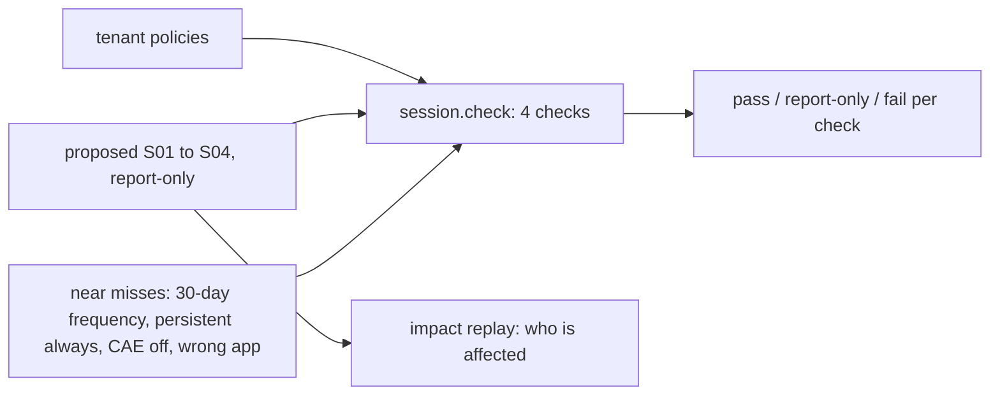

# Component: Entra ID session hardening

Stolen session cookies and tokens skip MFA, so what happens after sign-in matters. Four checks look at
Conditional Access session controls: re-authentication on sensitive apps, no persistent browser sessions on
unmanaged devices, device-bound tokens or strict continuous access evaluation for mail and files, and
limited app-enforced access from personal devices. A proposed policy set closes all four in report-only
mode first.

Sections: [1. Purpose](#1-purpose) · [2. Architecture](#2-architecture) · [3. How it works](#3-how-it-works) · [4. Key files](#4-key-files) · [5. Code excerpts](#5-code-excerpts) · [6. Configuration](#6-configuration) · [7. Commands](#7-commands) · [8. Real output](#8-real-output) · [9. Tests and gates](#9-tests-and-gates) · [10. Guardrails](#10-guardrails) · [11. Security and governance](#11-security-and-governance) · [12. Observability](#12-observability) · [13. Failure modes](#13-failure-modes) · [14. Mapping to Azure services](#14-mapping-to-azure-services) · [15. Limitations](#15-limitations) · [16. Interview talking points](#16-interview-talking-points)

## 1. Purpose

* Show the four session gaps in the synthetic tenant (it has no session controls at all).
* Offer a report-only policy set that closes them, and prove that near-miss policies do not count.

## 2. Architecture



## 3. How it works

1. Each check is a predicate over one policy; a check passes when an enabled policy satisfies it and is
   `report-only` when only a report-only policy does.
2. `proposed()` writes S01 to S04 with the emergency-access group excluded.
3. `near_misses()` are enabled policies that look right but are not (for example a 30-day sign-in frequency).

## 4. Key files

| File | Role |
|---|---|
| `src/idsec/session.py` | Checks, proposed policies, near misses and evaluation |
| `src/idsec/impact.py` | Replays the proposed set against sign-ins |

## 5. Code excerpts

<!-- code: src/idsec/session.py::proposed -->
```python
def proposed() -> list[dict]:
    """The hardening set, written report-only so its impact can be measured before anyone enforces it."""
    return [
        _policy("S01 Sign-in frequency 4h on sensitive apps", SENSITIVE_APPS, {"signInFrequency": {"isEnabled": True, "value": 4, "type": "hours"}}),
        _policy(
            "S02 No persistent browser on unmanaged devices",
            ["All"],
            {"persistentBrowser": {"isEnabled": True, "mode": "never"}},
            devices=UNMANAGED,
            clients=("browser",),
        ),
        _policy(
            "S03 Token protection and strict CAE for mail and files",
            MAIL_FILES,
            {"secureSignInSession": {"isEnabled": True}, "continuousAccessEvaluation": {"mode": "strictEnforcement"}},
            clients=("mobileAppsAndDesktopClients",),
        ),
        _policy(
            "S04 App-enforced restrictions for BYOD",
            MAIL_FILES,
            {"applicationEnforcedRestrictions": {"isEnabled": True}},
            devices=UNMANAGED,
            clients=("browser",),
        ),
    ]
```
<!-- /code -->

## 6. Configuration

`SENSITIVE_APPS`, `MAIL_FILES` and `MAX_SIF_HOURS` (8) are constants in `session.py`.

## 7. Commands

```bash
idsec session
idsec impact     # who the proposed set would affect
```

## 8. Real output

<!-- output: session -->
```text
Entra ID session hardening (synthetic Kestrel Ridge Mortgage)

Today:
  fail        sign-in-frequency-sensitive-apps: sensitive apps re-authenticate at least every 8 hours
  fail        no-persistent-browser-unmanaged: unmanaged browsers cannot keep a persistent session
  fail        token-protection-or-strict-cae: mail and file tokens are device-bound or revoked in near real time
  fail        app-enforced-restrictions-byod: unmanaged devices get limited, browser-only access to mail and files

With the proposed set in report-only:
  report-only sign-in-frequency-sensitive-apps: sensitive apps re-authenticate at least every 8 hours (S01 Sign-in frequency 4h on sensitive apps)
  report-only no-persistent-browser-unmanaged: unmanaged browsers cannot keep a persistent session (S02 No persistent browser on unmanaged devices)
  report-only token-protection-or-strict-cae: mail and file tokens are device-bound or revoked in near real time (S03 Token protection and strict CAE for mail and files)
  report-only app-enforced-restrictions-byod: unmanaged devices get limited, browser-only access to mail and files (S04 App-enforced restrictions for BYOD)

Near-miss policies (look like the control, are not):
  fail        sign-in-frequency-sensitive-apps
  fail        no-persistent-browser-unmanaged
  fail        token-protection-or-strict-cae
  fail        app-enforced-restrictions-byod

Measured:
  checks: 4
  tenant_today: {'pass': 0, 'report-only': 0, 'fail': 4}
  with_proposed_report_only: {'pass': 0, 'report-only': 4, 'fail': 0}
  with_proposed_enforced: {'pass': 4, 'report-only': 0, 'fail': 0}
  near_miss_policies_passing: 0
  proposed_exclude_emergency_accounts: True
```
<!-- /output -->

## 9. Tests and gates

`tests/test_posture_packs.py` covers this pack; `idsec gate` adds a release check for it (see [metrics and release gate](metrics-gate.md)). Tests cover each near miss, disabled policies, the frequency threshold and the emergency-group exclusion.

## 10. Guardrails

* The proposed set starts in report-only mode and excludes the emergency-access group.
* Nothing is written to a tenant; enforcement is a separate, approved change.

## 11. Security and governance

Token protection and strict continuous access evaluation shorten the life of a stolen token; app-enforced
restrictions stop downloads from personal devices.

## 12. Observability

Every check prints the policy that satisfied it, so a pass can be traced to one policy.

## 13. Failure modes

| Failure | Effect | Handling |
|---|---|---|
| Token protection breaks an older client | Users cannot open mail on that client | Replay with `idsec impact` and stage the rollout |
| Frequency too short | Prompt fatigue | Keep it to sensitive apps only |

## 14. Mapping to Azure services

| Here | In Azure |
|---|---|
| Session controls | **Entra ID** Conditional Access session controls, managed with **Microsoft Graph** |
| Admin portals | Protected further by **PIM** activation and phishing-resistant MFA |
| Device state | Intune compliance; unmanaged means not compliant |

**Entra Agent ID** identities and **Foundry** agents use workload tokens, which these user-session controls do not cover. **Defender for Cloud** is not involved.

## 15. Limitations

* The device condition is a reduced filter (compliant or not); real filters can be richer.
* Licensing differs per control; this tool does not check licences.

## 16. Interview talking points

* "MFA protects the sign-in; session controls protect everything after it."
* "Report-only first, measured with an impact replay, then enforce."
